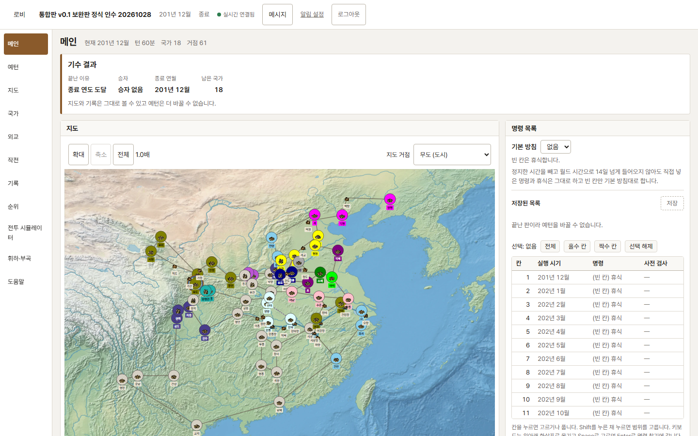
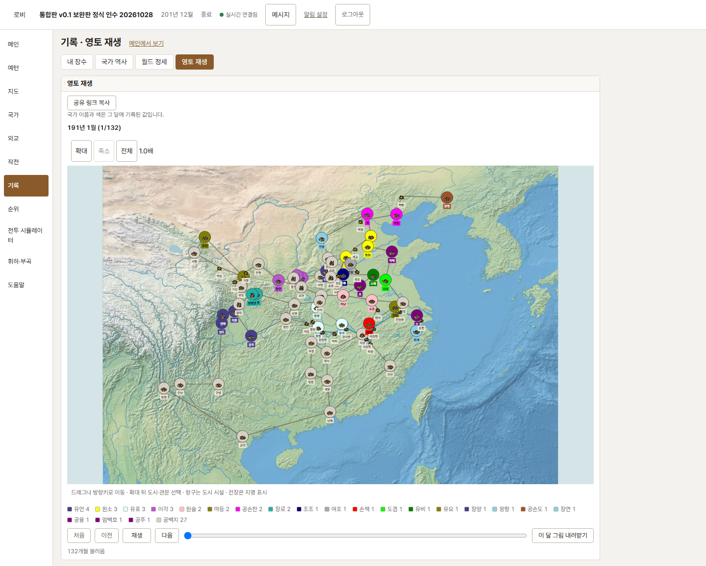

# opensamguk

여러 사람이 장수 한 명씩을 맡아 나라를 키우고 천하를 다투는 턴 예약형 삼국지 웹 전략 게임입니다.
원작 「삼국지 모의전투」([devsam/core2026](https://gitea.hided.net/devsam/core2026))의 핵심 루프와 기존 명령을 재사용하면서 현재 구조에 맞게 옮깁니다.

v1의 필요한 규칙과 데이터를 TypeScript 엔진·API·React에 연결했습니다. 페이지 구조도 v1의 실제 소스를 대조하며 공개 준비 과정에서 맞추고 있습니다.

## 지금 어디쯤인가

| 범위 | 상태와 근거 |
| --- | --- |
| 통합판 v0.1 | 유효 AC-INT 15개 완료. 정식 시나리오 132개월 완주·두 월드 격리·재시작·중복 입력·백업 복원·동일 시드 재생, 실제 PostgreSQL·Chromium 검사와 독립 리뷰 뒤 [PR #264](https://github.com/opensamguk/opensamguk/pull/264)로 병합 |
| 도시 자원 추가 범위 | [INT-18](docs/plans/INT-18.md)의 AC-INT-18A~D 4개는 구현·검증 중. 기존 통합판15개 완료와 별도이며 새 판의 실제 PG·Chromium·한 기수 인수·독립 리뷰·병합이 필요 |
| SAN10 지도 추가 범위 | [새 지도와 두 시나리오](docs/plans/san10-runtime.md)를 연결 중. 152전략 거점·159표식·200도로를 역사판(191년 21국·491장수)과 공백지판(180년 0국·491장수)에서 공유. 생성·초기화·도시 자원·공개 화면의 통합 검증과 독립 리뷰·병합이 필요 |
| 누구나 가입하는 공개 오픈 | 준비 중. 계정·동의·탈퇴·관리자·운영·부하·접근성·공개 인수의 남은 항목은 [공개 준비 체크리스트](docs/plans/public-opening-v01.md)에 기록. 서버·도메인·메일 서비스와 운영자·문의처는 미정 |

완료 범위는 [동결 출시 계획](docs/plans/integration-release.md), [현재 기능과 동결 범위](docs/product/feature-selection.md), [인수조건](docs/product/acceptance-criteria.md)을 따릅니다. 1턴은 1개월이고 장수 예약은 30칸입니다. 통솔·무력·지력(`intel`)·정치·매력의 5능력치를 씁니다. 기존 통합판은 191년 21국·491장수와 실제 GIS의 53도시·8관문·6항구 시설·13전장 표시로 인수했습니다. 사람 장수의 생성·출사·내정·동의에 따른 휘하 영입·부곡 편성·이동·전투·점령·기수 종료를 검증했습니다.

새 SAN10 지도에는 144도시·8관문과 항구 시설6곳·전장 표시1곳이 있습니다. 기존 월드의 지도·자원·재생 기록은 보존하며 새로 만드는 월드에 적용합니다. 모든 제안 연결을 합친 200도로는 게임 규칙이며 실제 역사 도로라는 뜻은 아닙니다. 실제 지형은 GIS 벡터를 사용합니다. 새 지도의 검증 상태는 위 추가 범위와 연결 문서에서 확인합니다.

군현 관리·지속 행군·5자원·피로·카드 명령·실시간/격자 전투·v1 전체 1,000명·원작 90명령 전부·새 공개 초상은 보류합니다. 과거 M1·M2·M3와 Phase 2의 미완료 기록은 보존하며 통합판 완료로 대신하지 않습니다. 다음 작업은 `pnpm next`로 확인합니다. 상태 기준은 2026-10-30입니다.

기존 전체 계획의 관문 집계도 보존합니다. 아래 표는 통합판 완료율과 별도이며 이전 AC의 미완료를 없애지 않습니다.

| 관문 | 완료 조건 | 상태 |
| --- | --- | --- |
| M1 혼자와 NPC로 한 판 완주 | [AC-M1 22개](docs/product/acceptance-criteria.md#m1) 통과 | 진행 중 (✅ 20 · 🟨 2 · ⬜ 0) | <!-- lint-text-ignore C-5 -->
| M2 독립 에이전트 참가 시험 | [AC-M2 20개](docs/product/acceptance-criteria.md#m2) 통과 | 진행 중 (✅ 4 · 🟨 3 · ⬜ 13) | <!-- lint-text-ignore C-5 -->
| M3 기존 전체 인수 | [AC-M3 16개](docs/product/acceptance-criteria.md#m3) 통과 | 진행 중 (✅ 0 · 🟨 1 · ⬜ 15) | <!-- lint-text-ignore C-5 -->

이번 공개의 M3 필수 조건은 [D-039](docs/product/decisions.md#d-039-공개-준비에서도-v01의-후속-게임-기능을-보존한다-2026-10-29)에 따라 AC-M3-01~11과16의12개입니다. AC-M3-12~15는 후속 미완료로 보존합니다. 도시 금·쌀·수비병과 부곡 배속은 [D-040](docs/product/decisions.md#d-040-도시가-금쌀수비병을-보유하고-권한자가-부곡에-배속한다-2026-10-29)의 추가 범위이며 기존 월드의 자원과 재생을 바꾸지 않습니다.

과거 전체 명령의 미완료 목록은 [명령 대응표](docs/product/command-coverage.json)에 남깁니다. `node tools/command-coverage.mjs`의 현재 원작 비교 분모 90개, 정본 분모 91개, 전 단계 완료 0개입니다. D-038에 따라 이 전체 명령 분모를 이번 통합판의 완료 분모로 쓰지 않습니다.

## 실행 화면

정식 인수 월드의 실제 Chromium 화면입니다. 첫 그림은 132개월을 마친 201년 12월이고 두 번째는 같은 월드의 월간 영토 재생입니다. GIS와 기존 자작 도트를 쓰며 원작 초상은 담지 않았습니다. v1을 참고한 공통 탐색을 반영한 개발 화면이며 전체 UI 인수는 진행 중입니다.





## 문서

| 알고 싶은 것          | 문서                                                   |
| --------------------- | ------------------------------------------------------ |
| 지금 출시하는 범위    | [통합판 v0.1](docs/plans/integration-release.md)       |
| 공개 전에 남은 일     | [공개 오픈 준비](docs/plans/public-opening-v01.md)    |
| 무엇을 왜 만드나      | [PRD](docs/product/prd.md)                             |
| 언제 끝났다고 하나    | [인수조건](docs/product/acceptance-criteria.md)        |
| 어떤 순서로 하나      | [단계 계획](docs/product/phases.md)                    |
| 작업 규칙 (사람·AI)   | [AGENTS.md](AGENTS.md)                                 |
| 전체 문서 지도        | [docs/index.md](docs/index.md)                         |

## 기술 스택

TypeScript · Node.js 24 · pnpm workspace · Fastify · tRPC · zod · React · Vite · TanStack Query ·
PostgreSQL · Prisma · Vitest · Playwright · Docker Compose · Caddy

## 저장소 구성

| 경로               | 책임                                              |
| ------------------ | ------------------------------------------------- |
| `apps/web`         | 로비와 게임 화면 (React SPA)                      |
| `apps/server`      | 계정·로비·게임 API, SSE                           |
| `apps/engine`      | 월드별 턴 엔진, NPC AI, 월간 정산                 |
| `packages/rules`   | 순수 게임 규칙 (명령, 전투, 경제). DB·IO 없음     |
| `packages/shared`  | 공통 타입, zod schema, 결정적 RNG                 |
| `packages/db`      | Prisma schema, migration, DB client               |
| `resources/`       | 지도, 시나리오, 병종, 월드 프리셋                 |
| `tools/`           | 시뮬레이터, 문서 생성, 검사 스크립트              |
| `docs/`            | 제품·아키텍처·개발·플레이어·운영 문서             |

## 개발

Node.js 24 이상, pnpm 10.33, Docker Compose를 씁니다. 새 개발 환경에서는 `.env.example`을 `.env`로 복사하고 전용 DB와 비어 있는 포트를 지정합니다. 기존 `.env`나 사용자 DB를 덮어쓰지 않습니다. 기본값은 PostgreSQL 5433, API 3001, 웹 5173입니다.

```sh
pnpm install
pnpm generate
pnpm db:up
pnpm db:migrate
pnpm db:init-resources
pnpm db:init-integration
pnpm db:init-san10
```

[시나리오 생성 명령](docs/plans/san10-runtime.md#생성과-적용)으로 새 SAN10 월드를 만듭니다. 기본 `regular` 프리셋은 역사판이며 `empty` 프리셋은 공백지판입니다. 기존 통합판의 명시 자원 선택은 [동결 출시 계획](docs/plans/integration-release.md#중간-시연과-종료-조건)에 보존합니다. 출력된 ID로 `pnpm world:start --world <월드-ID>`를 실행합니다. `pnpm dev`로 web·API·engine을 기동하고 [로컬 게임](http://127.0.0.1:5173)에 접속해 가입·장수 생성을 진행합니다. 개발 메일은 `.mail-outbox`에 저장되며 공개 발송은 별도 설정과 검증이 필요합니다.

코드와 검증 규칙은 [개발자 핸드북](docs/developer/index.md)과 [테스트 정책](docs/testing-policy.md)을 따릅니다.

| 명령 | 용도 |
| --- | --- |
| `pnpm install` | 의존성 설치 |
| `pnpm check` | Prisma 생성, lint, 글·포맷 검사, 타입 검사, 단위 시험, 다음 작업 출력 |
| `pnpm format` | Prettier로 포맷 수정 |
| `pnpm format:check` | 포맷 검사 |
| `pnpm next` | 다음 작업과 담당 확인 |
| `pnpm db:up` | 로컬 PostgreSQL 시작 |
| `pnpm dev` | web·server·engine 개발 서버 실행 |
| `pnpm e2e` | Playwright 시험 |
| `pnpm test:int` | 전용 PostgreSQL DB 통합 시험 |
| `pnpm db:migrate` | DB migration 적용 |
| `pnpm db:init-resources` | 내장 자원을 GameResource에 초기화 |
| `pnpm db:init-integration` | 통합판 지도·시나리오·5능력치 자원을 초기화 |
| `pnpm db:init-scenarios` | 준비된 추가 시나리오 9개를 DB에 초기화 |
| `pnpm sim` | NPC 시뮬레이터 실행 |
| `pnpm test:authz` | 실제 HTTP·PostgreSQL 권한 대조 |
| `pnpm build:public` | 공개 전용 빌드와 자산 검사 |
| `pnpm e2e:public` | 공개 빌드 Chromium 검사 |

추가 시나리오 9개가 필요하면 `pnpm db:init-scenarios`를 실행합니다. 월드 생성 CLI는 기본 JSON 또는 `--published`의 게시 자원을 읽습니다. 실제 DB 검사는 전용 테스트 DB로 실행하고 Chromium은 `pnpm exec playwright install chromium`으로 준비합니다.

`pnpm sim` 실행만으로 개발 PC 시간 기준인 AC-M1-18이 통과한 것은 아닙니다. 완료 여부는 인수조건의 상태와 증거로 확인합니다.


## 관련 저장소와 공개 이미지

이미지 저장소는 [opensamguk/opensamguk-images](https://github.com/opensamguk/opensamguk-images), 기존 배포 저장소는 [opensamguk/opensamguk-docker](https://github.com/opensamguk/opensamguk-docker)로 이전했습니다. 이미지 개발용 고정 커밋 `48163bd1ce8d54c54c94fb5484b05f9db9e50c62`와 초상 ID·경로 계약은 유지합니다.

공개 빌드는 기본 SVG 초상과 승인된 GIS·자작 도트만 묶습니다. 원작 초상은 공개 세트에서 빼고 장수 이름·능력치와 출처·NOTICE는 보존합니다. 외부 초상을 공개하지 않는 승인 목록은 `imageRepoCommit: null`, `imageBaseUrls: []`, `portraitIds: []`입니다. 저장소 이전은 그림의 공개 이용 허락을 뜻하지 않습니다. 공개 빌드·자산 검사·배포와 이미지 서버 직접 제공 정책의 검증은 [T3-13](docs/plans/T3-13.md)과 AC-M3-06에서 따로 확인합니다.


## 참고와 라이선스

- core2026 (MIT, © 2025 devsam): 구조와 규칙을 참고합니다. 코드나 리소스를 옮길 때는 출처와 MIT 고지를 남깁니다.
- 이미지: [이미지 자산](docs/image-assets.md)을 보세요. 공개 전에 라이선스 관문(AC-M3-06)을 통과해야 합니다.
- 이 저장소의 코드와 문서는 [MIT](LICENSE)입니다. 옮겨 온 리소스의 출처와 원 라이선스는 [resources/NOTICE.md](resources/NOTICE.md)에 있습니다.
  이미지 저장소의 그림은 이 라이선스에 포함되지 않습니다 ([이미지 자산](docs/image-assets.md) §3).

v1 원본은 [peppone-choi/opensamguk-v1](https://github.com/peppone-choi/opensamguk-v1)의 커밋 `bc053629710711d4c5dfa50683bae78f4baeca95`입니다. 비공개 참고 저장소이며 라이선스는 MIT입니다. 원 고지는 `Copyright (c) 2026 빼뽀네 (peppone-choi) and OpenSamguk contributors`입니다. 코드를 옮길 때 파일 출처와 원 MIT 고지를 남깁니다.
